# 🖥️ 개발 워크스테이션 구축 기술 문서

## 📋 프로젝트 개요

이 문서는 Docker/Git 기반 개발 워크스테이션 구축 과제의 수행 결과를 기록한 기술 문서입니다.

**미션 목표 요약**
- 터미널 기본 조작 및 파일 권한 이해
- Docker 설치/운영/이미지 제작 실습
- Dockerfile 기반 커스텀 웹 서버 컨테이너 구축
- 포트 매핑 / 바인드 마운트 / 볼륨 영속성 검증
- Git 설정 및 GitHub 연동 완료

---

## 🛠️ 실행 환경

| 항목 | 버전 |
|------|------|
| OS | Windows 11 Pro (Build 26300.9711) |
| Python | 3.15.2 |
| Shell| bash |
| Docker | 29.9.2 |
| Git | 2.56.0 |

---

## ✅ 수행 항목 체크리스트

| 항목 | 완료 여부 |
|------|-----------|
| 작업폴더 및 환경 파악| -[x]- |
| 터미널 기본 조작 | -[x]- |
| 파일 권한 확인/변경 | -[x]- |
| Docker 설치 및 점검 | -[]- |
| Docker 기본 운영 명령 | -[]- |
| hello-world 컨테이너 실행 | -[]- |
| ubuntu 컨테이너 진입 | -[]- |
| Dockerfile 작성 및 커스텀 이미지 빌드 | -[]- |
| 포트 매핑 및 브라우저 접속 확인 | -[]- |
| 바인드 마운트 실습 | -[]- |
| Docker 볼륨 영속성 검증 | -[]- |
| Git 사용자 설정 | -[]- |
| GitHub 연동 | -[]- |

---

## 1. 터미널 기본 조작 로그

### 1-1. 현재 위치 / 목록 확인 (숨김 파일 포함) / 폴더 이동 / 생성 / 복사 / 이동·이름변경 / 삭제

```
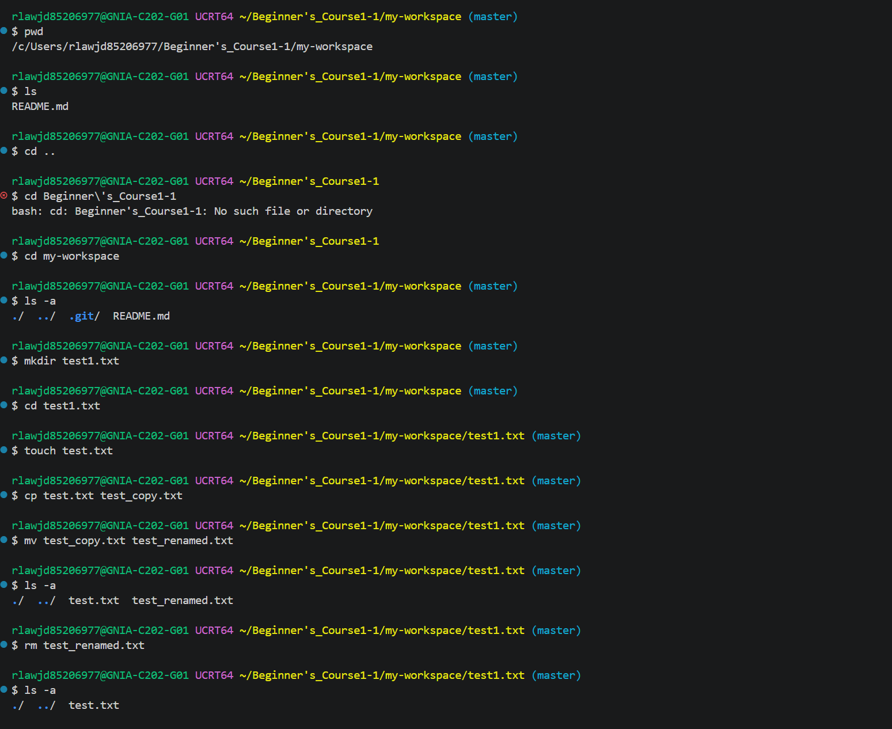
3
```

### 1-2. 파일 내용 확인 / 빈 파일 생성

```

```

---

## 2. 파일 권한 실습

### 2-1. 권한 확인 (변경 전)

```
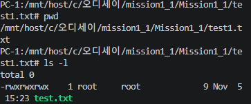
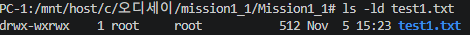
```

### 2-2. 권한 변경 (파일 1개 + 디렉토리 1개)

```

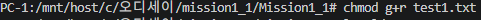
```

### 2-3. 권한 확인 (변경 후)

```


```

---

## 3. Docker 설치 및 기본 점검

### 3-1. Docker 버전 확인

```

```

### 3-2. Docker 데몬 동작 확인

```
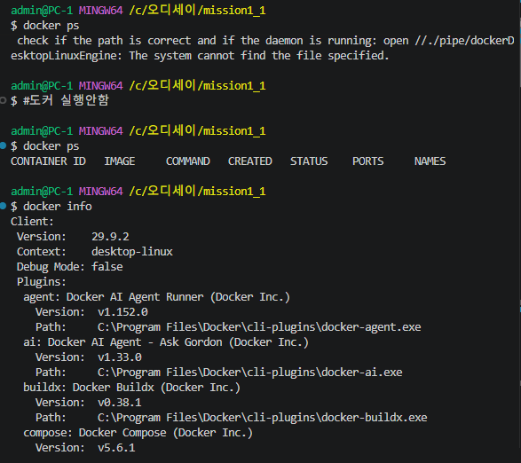
```

---

## 4. Docker 기본 운영 명령

### 4-1. 이미지 다운로드 및 목록 확인

```
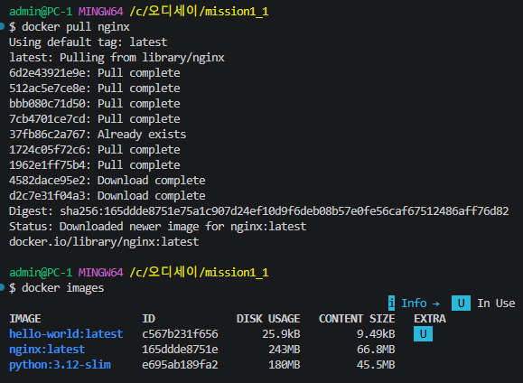
```

### 4-2. 컨테이너 실행 / 중지 / 목록 확인

```
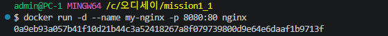
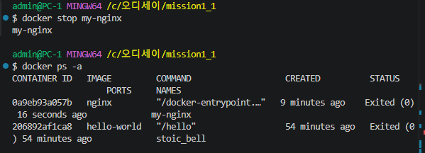

```

### 4-3. 로그 확인 / 리소스 확인

```
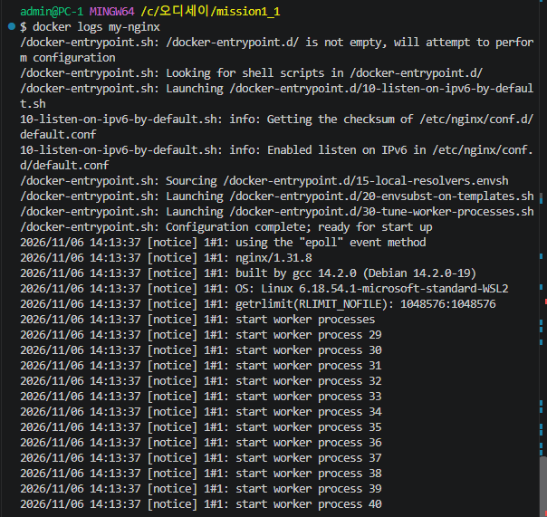
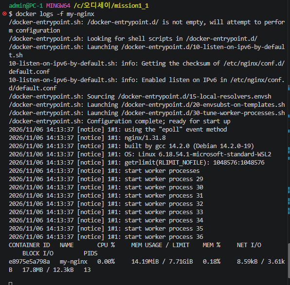
```

---

## 5. 컨테이너 실행 실습

### 5-1. hello-world 실행

```
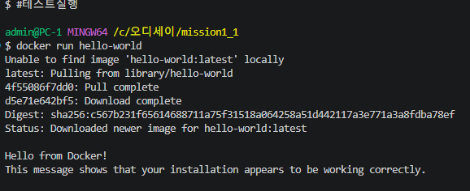
```

### 5-2. ubuntu 컨테이너 진입 및 명령 수행

```
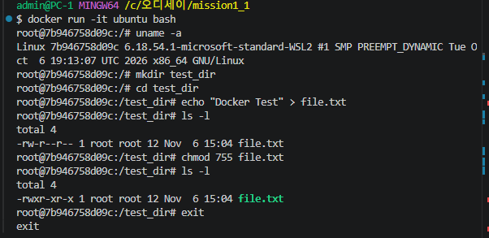

```

### 5-3. attach vs exec 차이 관찰 정리

```
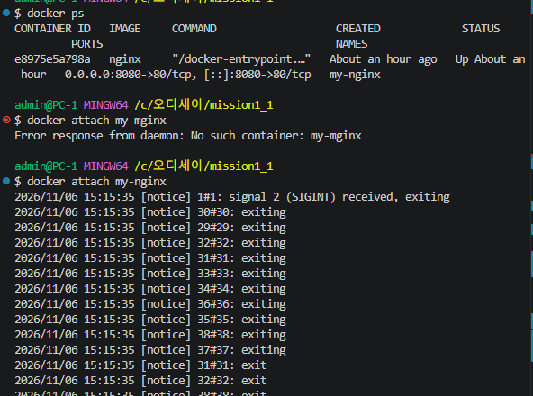
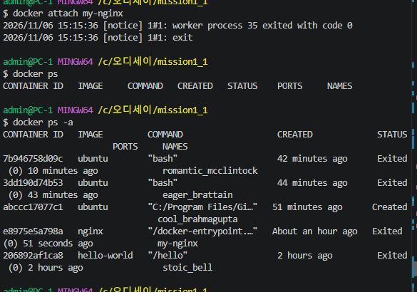
exit시 nginx 컨테이너 중지됌#용도:로그 모니터링
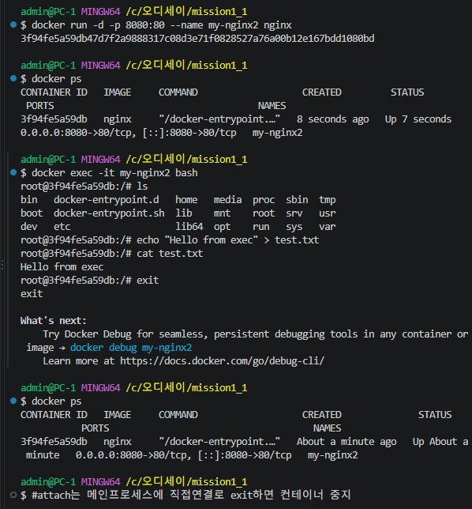
exit시 nginx 컨테이너 중지안됌#용도:작업,디버깅
```

---

## 6. Dockerfile 기반 커스텀 이미지 제작

### 6-1. 선택한 방식

> (A) NGINX 베이스 이미지 + 정적 콘텐츠 교체

### 6-2. Dockerfile 내용

```dockerfile
-실습미수행-
```

### 6-3. 커스텀 포인트 및 목적

| 커스텀 포인트 | 목적 |
|--------------|------|
| -실습미수행- | -실습미수행- |

### 6-4. 빌드 명령 및 결과

```bash
-실습미수행-
```

### 6-5. 컨테이너 실행 명령 및 결과

```bash
-실습미수행-
```

---

## 7. 포트 매핑 및 브라우저 접속 증거

### 7-1. 실행 명령

```bash
-실습미수행-
```

### 7-2. 브라우저 접속 화면 (주소창 + 응답 화면 포함)

> -실습미수행- (스크린샷 첨부 예정)

---

## 8. 바인드 마운트 실습

### 8-1. 실행 명령

```bash
-실습미수행-
```

### 8-2. 호스트 변경 전 화면

> -실습미수행- (스크린샷 첨부 예정)

### 8-3. 호스트 변경 후 화면

> -실습미수행- (스크린샷 첨부 예정)

---

## 9. Docker 볼륨 영속성 검증

### 9-1. 볼륨 생성 및 컨테이너 연결

```bash
-실습미수행-
```

### 9-2. 컨테이너 삭제 전 데이터 확인

```bash
-실습미수행-
```

### 9-3. 컨테이너 삭제 후 데이터 확인 (영속성 증명)

```bash
-실습미수행-
```

---

## 10. Git 설정 및 GitHub 연동

### 10-1. Git 사용자 정보 / 기본 브랜치 설정

```bash
-실습미수행-
```

### 10-2. git config --list 결과

```bash
-실습미수행-
```

### 10-3. GitHub 연동 증거

> -실습미수행- (스크린샷 첨부 예정)

---

## 🔍 검증 방법 및 결과 위치

| 검증 항목 | 사용 명령 | 결과 위치 |
|-----------|-----------|-----------|
| Docker 설치 확인 | `docker --version` | [3-1 섹션](#3-1-docker-버전-확인) |
| 이미지 빌드 확인 | `docker images` | [6-4 섹션](#6-4-빌드-명령-및-결과) |
| 포트 접속 확인 | 브라우저 접속 | [7-2 섹션](#7-2-브라우저-접속-화면-주소창--응답-화면-포함) |
| 볼륨 영속성 확인 | `docker volume inspect` | [9-3 섹션](#9-3-컨테이너-삭제-후-데이터-확인-영속성-증명) |
| Git 설정 확인 | `git config --list` | [10-2 섹션](#10-2-git-config---list-결과) |

---

## 🚨 트러블슈팅 (2건 이상)

### Case 1: -실습미수행-

| 항목 | 내용 |
|------|------|
| 문제 발견 : chmod +x 가 적용 안됌 | 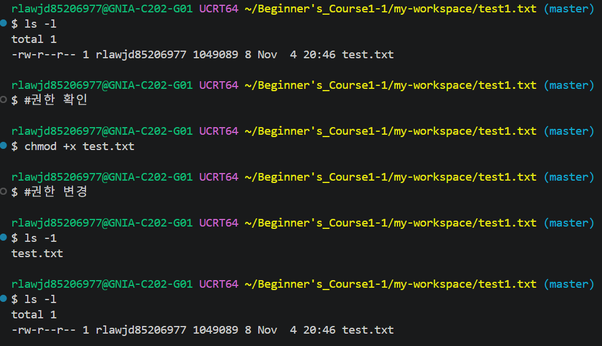 |
| 원인 : Windows 환경 제한 |
| 확인 방법 |네이토에게 질문 |
| 해결/대안:해결 실패 Windows NTFS 파일시스템은 Linux 권한 체계를 완전히 지원하지 않음 |

### Case 2: -실습미수행-

| 항목 | 내용 |
|------|------|
| 문제 | -실습미수행- |
| 원인 가설 | -실습미수행- |
| 확인 방법 | -실습미수행- |
| 해결/대안 | -실습미수행- |

---

## 📝 보너스 과제 (선택)

### B-1. Docker Compose 기초

```yaml
-실습미수행-
```

### B-2. Docker Compose 멀티 컨테이너

```bash
-실습미수행-
```

### B-3. Compose 운영 명령어

```bash
-실습미수행-
```

### B-4. 환경 변수 활용

```bash
-실습미수행-
```

### B-5. GitHub SSH 키 설정

```bash
-실습미수행-
```

---

## 로그

rlawjd85206977@GNIA-C202-G01 UCRT64 ~/Beginner's_Course1-1/my-workspace (master)
$ #==============================

rlawjd85206977@GNIA-C202-G01 UCRT64 ~/Beginner's_Course1-1/my-workspace (master)
$ #1. 터미널 기본 조작

rlawjd85206977@GNIA-C202-G01 UCRT64 ~/Beginner's_Course1-1/my-workspace (master)
$ #==============================

rlawjd85206977@GNIA-C202-G01 UCRT64 ~/Beginner's_Course1-1/my-workspace (master)
$ pwd
/c/Users/rlawjd85206977/Beginner's_Course1-1/my-workspace

rlawjd85206977@GNIA-C202-G01 UCRT64 ~/Beginner's_Course1-1/my-workspace (master)
$ ls
README.md

rlawjd85206977@GNIA-C202-G01 UCRT64 ~/Beginner's_Course1-1/my-workspace (master)
$ ls -Force
ls: unknown option -- e
Try 'ls --help' for more information.

rlawjd85206977@GNIA-C202-G01 UCRT64 ~/Beginner's_Course1-1/my-workspace (master)
$ #파워셀이 아닌 긱 배쉬라서 명령어가 다름

rlawjd85206977@GNIA-C202-G01 UCRT64 ~/Beginner's_Course1-1/my-workspace (master)
$ ls -la
total 16
drwxr-xr-x 1 rlawjd85206977 1049089    0 Nov  4 19:08 ./
drwxr-xr-x 1 rlawjd85206977 1049089    0 Nov  4 15:03 ../
drwxr-xr-x 1 rlawjd85206977 1049089    0 Nov  4 19:08 .git/
-rw-r--r-- 1 rlawjd85206977 1049089 6434 Nov  4 20:04 README.md

rlawjd85206977@GNIA-C202-G01 UCRT64 ~/Beginner's_Course1-1/my-workspace (master)
$ #저장소/작업 폴더 확인 완료

rlawjd85206977@GNIA-C202-G01 UCRT64 ~/Beginner's_Course1-1/my-workspace (master)
$ #실행 환경 파악

rlawjd85206977@GNIA-C202-G01 UCRT64 ~/Beginner's_Course1-1/my-workspace (master)
$ winver

rlawjd85206977@GNIA-C202-G01 UCRT64 ~/Beginner's_Course1-1/my-workspace (master)
$ python --version
Python 3.15.2

rlawjd85206977@GNIA-C202-G01 UCRT64 ~/Beginner's_Course1-1/my-workspace (master)
$ docker --version
Docker version 29.9.2, build a82e528

rlawjd85206977@GNIA-C202-G01 UCRT64 ~/Beginner's_Course1-1/my-workspace (master)
$ git --version
git version 2.56.0.windows.4

rlawjd85206977@GNIA-C202-G01 UCRT64 ~/Beginner's_Course1-1/my-workspace (master)
$ #환경 파악완료

rlawjd85206977@GNIA-C202-G01 UCRT64 ~/Beginner's_Course1-1/my-workspace (master)
$ pwd
/c/Users/rlawjd85206977/Beginner's_Course1-1/my-workspace

rlawjd85206977@GNIA-C202-G01 UCRT64 ~/Beginner's_Course1-1/my-workspace (master)
$ ls
README.md

rlawjd85206977@GNIA-C202-G01 UCRT64 ~/Beginner's_Course1-1/my-workspace (master)
$ cd ..

rlawjd85206977@GNIA-C202-G01 UCRT64 ~/Beginner's_Course1-1
$ cd Beginner\'s_Course1-1
bash: cd: Beginner's_Course1-1: No such file or directory

rlawjd85206977@GNIA-C202-G01 UCRT64 ~/Beginner's_Course1-1
$ cd my-workspace

rlawjd85206977@GNIA-C202-G01 UCRT64 ~/Beginner's_Course1-1/my-workspace (master)
$ ls -a
./  ../  .git/  README.md

rlawjd85206977@GNIA-C202-G01 UCRT64 ~/Beginner's_Course1-1/my-workspace (master)
$ mkdir test1.txt

rlawjd85206977@GNIA-C202-G01 UCRT64 ~/Beginner's_Course1-1/my-workspace (master)
$ cd test1.txt

rlawjd85206977@GNIA-C202-G01 UCRT64 ~/Beginner's_Course1-1/my-workspace/test1.txt (master)
$ touch test.txt

rlawjd85206977@GNIA-C202-G01 UCRT64 ~/Beginner's_Course1-1/my-workspace/test1.txt (master)
$ cp test.txt test_copy.txt

rlawjd85206977@GNIA-C202-G01 UCRT64 ~/Beginner's_Course1-1/my-workspace/test1.txt (master)
$ mv test_copy.txt test_renamed.txt

rlawjd85206977@GNIA-C202-G01 UCRT64 ~/Beginner's_Course1-1/my-workspace/test1.txt (master)
$ ls -a
./  ../  test.txt  test_renamed.txt

rlawjd85206977@GNIA-C202-G01 UCRT64 ~/Beginner's_Course1-1/my-workspace/test1.txt (master)
$ rm test_renamed.txt

rlawjd85206977@GNIA-C202-G01 UCRT64 ~/Beginner's_Course1-1/my-workspace/test1.txt (master)
$ ls -a
./  ../  test.txt

rlawjd85206977@GNIA-C202-G01 UCRT64 ~/Beginner's_Course1-1/my-workspace/test1.txt (master)
$ # 빈 폴더 파일생성 파일 내용확인 복사 이름변경 목록 확인 삭제

rlawjd85206977@GNIA-C202-G01 UCRT64 ~/Beginner's_Course1-1/my-workspace/test1.txt (master)
$ #cat추가

rlawjd85206977@GNIA-C202-G01 UCRT64 ~/Beginner's_Course1-1/my-workspace/test1.txt (master)
$ cat test.txt

rlawjd85206977@GNIA-C202-G01 UCRT64 ~/Beginner's_Course1-1/my-workspace/test1.txt (master)
$ # 파일에 내용 쓰기
echo "Pikachu" > test.txt

rlawjd85206977@GNIA-C202-G01 UCRT64 ~/Beginner's_Course1-1/my-workspace/test1.txt (master)
$ cat test.txt
Pikachu

rlawjd85206977@GNIA-C202-G01 UCRT64 ~/Beginner's_Course1-1/my-workspace/test1.txt (master)
$ #터미널 기본 조작 완료

rlawjd85206977@GNIA-C202-G01 UCRT64 ~/Beginner's_Course1-1/my-workspace/test1.txt (master)
$ #==========

rlawjd85206977@GNIA-C202-G01 UCRT64 ~/Beginner's_Course1-1/my-workspace/test1.txt (master)
$ #파일 권한 확인/변경

rlawjd85206977@GNIA-C202-G01 UCRT64 ~/Beginner's_Course1-1/my-workspace/test1.txt (master)
$ #===========

##########################장소변경##########################
admin@PC-1 MINGW64 /c/오디세이/mission1_1
$ #======파일 권한 확인/변경 시작 =======

admin@PC-1 MINGW64 /c/오디세이/mission1_1
$ ls -l
total 0
drwxr-xr-x 1 admin 197610 0 Nov  6 00:23 Mission1_1/

admin@PC-1 MINGW64 /c/오디세이/mission1_1
$ cd Mission1_1

admin@PC-1 MINGW64 /c/오디세이/mission1_1/Mission1_1 (master)
$ ls -l
total 16
drwxr-xr-x 1 admin 197610     0 Nov  6 00:23 assets/
-rw-r--r-- 1 admin 197610 11017 Nov  6 00:23 README.md
drwxr-xr-x 1 admin 197610     0 Nov  6 00:23 test1.txt/

admin@PC-1 MINGW64 /c/오디세이/mission1_1/Mission1_1 (master)
$ #=======권한 읽기 배움 맨앞은 파일형식 그다음부 터 3개씩 소유자 그룹 그외 rwx 3자리씩이다.

admin@PC-1 MINGW64 /c/오디세이/mission1_1/Mission1_1 (master)
$ chmod g-r test1.txt

admin@PC-1 MINGW64 /c/오디세이/mission1_1/Mission1_1 (master)
$ ls -l
total 16
drwxr-xr-x 1 admin 197610     0 Nov  6 00:23 assets/
-rw-r--r-- 1 admin 197610 11017 Nov  6 00:23 README.md
drwxr-xr-x 1 admin 197610     0 Nov  6 00:23 test1.txt/

admin@PC-1 MINGW64 /c/오디세이/mission1_1/Mission1_1 (master)
$ #==========트러블!발생 ============

admin@PC-1 MINGW64 /c/오디세이/mission1_1/Mission1_1 (master)
$ #Windows의 MINGW64 환경에서는 NTFS 파일시스템을 사용하기 때문에, Linux의 chmod 명령이 제대로 작동 하지 않을 수 있습니다.

admin@PC-1 MINGW64 /c/오디세이/mission1_1/Mission1_1 (master)
$ #폴더안 파일로 변경

admin@PC-1 MINGW64 /c/오디세이/mission1_1/Mission1_1 (master)
$ cd test1.txt

admin@PC-1 MINGW64 /c/오디세이/mission1_1/Mission1_1/test1.txt (master)
$ ls -l
total 1
-rw-r--r-- 1 admin 197610 9 Nov  6 00:23 test.txt

admin@PC-1 MINGW64 /c/오디세이/mission1_1/Mission1_1/test1.txt (master)
$ chmod g-r test.txt

admin@PC-1 MINGW64 /c/오디세이/mission1_1/Mission1_1/test1.txt (master)
$ ls -l
total 1
-rw-r--r-- 1 admin 197610 9 Nov  6 00:23 test.txt

admin@PC-1 MINGW64 /c/오디세이/mission1_1/Mission1_1/test1.txt (master)
$ #=============파일로해도 안됌 WSL로 전환

admin@PC-1 MINGW64 /c/오디세이/mission1_1/Mission1_1/test1.txt (master)
$ wsl
PC-1:/mnt/host/c/오디세이/mission1_1/Mission1_1/test1.txt# pwd
/mnt/host/c/오디세이/mission1_1/Mission1_1/test1.txt
PC-1:/mnt/host/c/오디세이/mission1_1/Mission1_1/test1.txt# ls -l
total 0
-rwxrwxrwx    1 root     root             9 Nov  5 15:23 test.txt
PC-1:/mnt/host/c/오디세이/mission1_1/Mission1_1/test1.txt# chmod g-r test.txt
PC-1:/mnt/host/c/오디세이/mission1_1/Mission1_1/test1.txt# ls -l
total 0
-rwx-wxrwx    1 root     root             9 Nov  5 15:23 test.txt
PC-1:/mnt/host/c/오디세이/mission1_1/Mission1_1/test1.txt# #=====권한바뀐거 확인!
PC-1:/mnt/host/c/오디세이/mission1_1/Mission1_1/test1.txt# 
PC-1:/mnt/host/c/오디세이/mission1_1/Mission1_1/test1.txt# #디렉토리권한변
경
PC-1:/mnt/host/c/오디세이/mission1_1/Mission1_1/test1.txt# ls -l
total 0
-rwx-wxrwx    1 root     root             9 Nov  5 15:23 test.txt
PC-1:/mnt/host/c/오디세이/mission1_1/Mission1_1/test1.txt# cd ..
PC-1:/mnt/host/c/오디세이/mission1_1/Mission1_1# pwd
/mnt/host/c/오디세이/mission1_1/Mission1_1
PC-1:/mnt/host/c/오디세이/mission1_1/Mission1_1# ls -ld
drwxrwxrwx    1 root     root           512 Nov  5 16:23 .
PC-1:/mnt/host/c/오디세이/mission1_1/Mission1_1# chmod g-r test1.txt
PC-1:/mnt/host/c/오디세이/mission1_1/Mission1_1# ls -ld
drwxrwxrwx    1 root     root           512 Nov  5 16:23 .
PC-1:/mnt/host/c/오디세이/mission1_1/Mission1_1# #실수
PC-1:/mnt/host/c/오디세이/mission1_1/Mission1_1# ls -ld test1.txt
drwx-wxrwx    1 root     root           512 Nov  5 15:23 test1.txt
PC-1:/mnt/host/c/오디세이/mission1_1/Mission1_1# chmod g+r test1.txt
PC-1:/mnt/host/c/오디세이/mission1_1/Mission1_1# ls -ld test1.txt
drwxrwxrwx    1 root     root           512 Nov  5 15:23 test1.txt
PC-1:/mnt/host/c/오디세이/mission1_1/Mission1_1# 

######################################
11/07 도커시작
admin@PC-1 MINGW64 /c/오디세이/mission1_1
$ docker --version
Docker version 29.9.2, build a82e528

admin@PC-1 MINGW64 /c/오디세이/mission1_1
$ docker ps
failed to connect to the docker API at npipe:////./pipe/dockerDesktopLinuxEngine; check if the path is correct and if the daemon is running: open //./pipe/dockerDesktopLinuxEngine: The system cannot find the file specified.

admin@PC-1 MINGW64 /c/오디세이/mission1_1
$ #도커 실행안함

admin@PC-1 MINGW64 /c/오디세이/mission1_1
$ docker ps
CONTAINER ID   IMAGE     COMMAND   CREATED   STATUS    PORTS     NAMES

admin@PC-1 MINGW64 /c/오디세이/mission1_1
$ docker info
Client:
 Version:    29.9.2
 Context:    desktop-linux
 Debug Mode: false
 Plugins:
  agent: Docker AI Agent Runner (Docker Inc.)
    Version:  v1.152.0
    Path:     C:\Program Files\Docker\cli-plugins\docker-agent.exe
  ai: Docker AI Agent - Ask Gordon (Docker Inc.)
    Version:  v1.33.0
    Path:     C:\Program Files\Docker\cli-plugins\docker-ai.exe
  buildx: Docker Buildx (Docker Inc.)
    Version:  v0.38.1
    Path:     C:\Program Files\Docker\cli-plugins\docker-buildx.exe
  compose: Docker Compose (Docker Inc.)
    Version:  v5.6.1
    Path:     C:\Program Files\Docker\cli-plugins\docker-compose.exe
  debug: Get a shell into any image or container (Docker Inc.)
    Version:  0.49.0
    Path:     C:\Program Files\Docker\cli-plugins\docker-debug.exe
  desktop: Docker Desktop commands (Docker Inc.)
    Version:  4.98.0
    Path:     C:\Program Files\Docker\cli-plugins\docker-desktop.exe
  dhi: CLI for managing Docker Hardened Images (Docker Inc.)
    Version:  v0.0.9
    Path:     C:\Program Files\Docker\cli-plugins\docker-dhi.exe
  extension: Manages Docker extensions (Docker Inc.)
    Version:  v0.2.32
    Path:     C:\Program Files\Docker\cli-plugins\docker-extension.exe
  init: Creates Docker-related starter files for your project (Docker Inc.)
    Version:  v1.4.1
    Path:     C:\Program Files\Docker\cli-plugins\docker-init.exe
  mcp: Docker MCP Plugin (Docker Inc.)
    Version:  v0.44.2
    Path:     C:\Program Files\Docker\cli-plugins\docker-mcp.exe
  model: Docker Model Runner (Docker Inc.)
    Version:  v1.2.9
    Path:     C:\Program Files\Docker\cli-plugins\docker-model.exe
  offload: Docker Offload (Docker Inc.)
    Version:  v0.7.35
    Path:     C:\Program Files\Docker\cli-plugins\docker-offload.exe
  pass: Docker Pass Secrets Manager Plugin (beta) (Docker Inc.)
    Version:  v0.3.2
    Path:     C:\Program Files\Docker\cli-plugins\docker-pass.exe
  sandbox: "docker sandbox" is deprecated, use Docker Sandboxes instead (Docker Inc.)
    Version:  v0.13.0
    Path:     C:\Program Files\Docker\cli-plugins\docker-sandbox.exe
  scout: Docker Scout (Docker Inc.)
    Version:  v1.27.0
    Path:     C:\Program Files\Docker\cli-plugins\docker-scout.exe

Server:
 Containers: 0
  Running: 0
  Paused: 0
  Stopped: 0
 Images: 1
 Server Version: 29.9.2
 Storage Driver: overlayfs
  driver-type: io.containerd.snapshotter.v1
 Logging Driver: local
 Cgroup Driver: cgroupfs
 Cgroup Version: 2
 Plugins:
  Volume: local
  Network: bridge host ipvlan macvlan null overlay
  Log: awslogs fluentd gcplogs gelf journald json-file local splunk syslog
 CDI spec directories:
  /etc/cdi
  /var/run/cdi
 Discovered Devices:
  cdi: docker.com/gpu=webgpu
 Swarm: inactive
 Runtimes: nvidia runc io.containerd.runc.v2
 Default Runtime: runc
 Init Binary: docker-init
 containerd version: b7a25261e029d68978bbf290df0a62fc819b3c51
 runc version: v1.5.2-0-g29dd3dc2
 init version: de40ad0
 Security Options:
  seccomp
   Profile: builtin
  cgroupns
 Kernel Version: 6.18.54.1-microsoft-standard-WSL2
 Operating System: Docker Desktop
 OSType: linux
 Architecture: x86_64
 CPUs: 12
 Total Memory: 7.71GiB
 Name: docker-desktop
 ID: fcbe8dc9-5ddd-4f4a-8ee8-5d4d0dedf210
 Docker Root Dir: /var/lib/docker
 Debug Mode: false
 HTTP Proxy: http.docker.internal:3128
 HTTPS Proxy: http.docker.internal:3128
 No Proxy: hubproxy.docker.internal
 Labels:
  com.docker.desktop.address=npipe://\\.\pipe\docker_cli
 Experimental: false
 Insecure Registries:
  hubproxy.docker.internal:5555
  127.0.0.0/8
  ::1/128
 Live Restore Enabled: false
 Firewall Backend: iptables


admin@PC-1 MINGW64 /c/오디세이/mission1_1
$ #테스트실행

admin@PC-1 MINGW64 /c/오디세이/mission1_1
$ docker run hello-world
Unable to find image 'hello-world:latest' locally
latest: Pulling from library/hello-world
4f55086f7dd0: Pull complete 
d5e71e642bf5: Download complete 
Digest: sha256:c567b231f65614688711a75f31518a064258a51d442117a3e771a3a8fdba78ef
Status: Downloaded newer image for hello-world:latest

Hello from Docker!
This message shows that your installation appears to be working correctly.

To generate this message, Docker took the following steps:
 1. The Docker client contacted the Docker daemon.
 2. The Docker daemon pulled the "hello-world" image from the Docker Hub.
    (amd64)
 3. The Docker daemon created a new container from that image which runs the
    executable that produces the output you are currently reading.
 4. The Docker daemon streamed that output to the Docker client, which sent it
    to your terminal.

To try something more ambitious, you can run an Ubuntu container with:
 $ docker run -it ubuntu bash

Share images, automate workflows, and more with a free Docker ID:
 https://hub.docker.com/

For more examples and ideas, visit:
 https://docs.docker.com/get-started/


admin@PC-1 MINGW64 /c/오디세이/mission1_1
$ docker pull nginx
Using default tag: latest
latest: Pulling from library/nginx
6d2e43921e9e: Pull complete 
512ac5e7ce8e: Pull complete 
bbb080c71d50: Pull complete 
7cb4701ce7cd: Pull complete 
37fb86c2a767: Already exists 
1724c05f72c6: Pull complete 
1962e1ff75b4: Pull complete 
4582dace95e2: Download complete 
d2c7e31f04a3: Download complete 
Digest: sha256:165ddde8751e75a1c907d24ef10d9f6deb08b57e0fe56caf67512486aff76d82
Status: Downloaded newer image for nginx:latest
docker.io/library/nginx:latest

admin@PC-1 MINGW64 /c/오디세이/mission1_1
$ docker images
                                                            i Info →   U  In Use
IMAGE                ID             DISK USAGE   CONTENT SIZE   EXTRA
hello-world:latest   c567b231f656       25.9kB         9.49kB    U   
nginx:latest         165ddde8751e        243MB         66.8MB        
python:3.12-slim     e695ab189fa2        180MB         45.5MB        

admin@PC-1 MINGW64 /c/오디세이/mission1_1
$ docker run -d --docker run -d --name my-nginx -p 8080:80 nginx
unknown flag: --docker

Usage:  docker run [OPTIONS] IMAGE [COMMAND] [ARG...]

Run 'docker run --help' for more information

What's next:
    Debug this container error with Gordon → docker ai "help me fix this container error"

admin@PC-1 MINGW64 /c/오디세이/mission1_1
$ docker run -d --name my-nginx -p 8080:80 nginx
0a9eb93a057b41f10d21b44c3a52418267a8f079739800d9e64e6daaf1b9713f

admin@PC-1 MINGW64 /c/오디세이/mission1_1
$ docker ps
CONTAINER ID   IMAGE     COMMAND                   CREATED          STATUS   PORTS                                     NAMES
0a9eb93a057b   nginx     "/docker-entrypoint.…"   35 seconds ago   Up 35 seconds  0.0.0.0:8080->80/tcp, [::]:8080->80/tcp   my-nginx

admin@PC-1 MINGW64 /c/오디세이/mission1_1
$ docker logs my-nginx
/docker-entrypoint.sh: /docker-entrypoint.d/ is not empty, will attempt to perform configuration
/docker-entrypoint.sh: Looking for shell scripts in /docker-entrypoint.d/
/docker-entrypoint.sh: Launching /docker-entrypoint.d/10-listen-on-ipv6-by-default.sh
10-listen-on-ipv6-by-default.sh: info: Getting the checksum of /etc/nginx/conf.d/default.conf
10-listen-on-ipv6-by-default.sh: info: Enabled listen on IPv6 in /etc/nginx/conf.d/default.conf
/docker-entrypoint.sh: Sourcing /docker-entrypoint.d/15-local-resolvers.envsh
/docker-entrypoint.sh: Launching /docker-entrypoint.d/20-envsubst-on-templates.sh/docker-entrypoint.sh: Launching /docker-entrypoint.d/30-tune-worker-processes.sh/docker-entrypoint.sh: Configuration complete; ready for start up
2026/11/06 13:56:59 [notice] 1#1: using the "epoll" event method
2026/11/06 13:56:59 [notice] 1#1: nginx/1.31.8
2026/11/06 13:56:59 [notice] 1#1: built by gcc 14.2.0 (Debian 14.2.0-19) 
2026/11/06 13:56:59 [notice] 1#1: OS: Linux 6.18.54.1-microsoft-standard-WSL2
2026/11/06 13:56:59 [notice] 1#1: getrlimit(RLIMIT_NOFILE): 1048576:1048576
2026/11/06 13:56:59 [notice] 1#1: start worker processes
2026/11/06 13:56:59 [notice] 1#1: start worker process 29
2026/11/06 13:56:59 [notice] 1#1: start worker process 30
2026/11/06 13:56:59 [notice] 1#1: start worker process 31
2026/11/06 13:56:59 [notice] 1#1: start worker process 32
2026/11/06 13:56:59 [notice] 1#1: start worker process 33
2026/11/06 13:56:59 [notice] 1#1: start worker process 34
2026/11/06 13:56:59 [notice] 1#1: start worker process 35
2026/11/06 13:56:59 [notice] 1#1: start worker process 36
2026/11/06 13:56:59 [notice] 1#1: start worker process 37
2026/11/06 13:56:59 [notice] 1#1: start worker process 38
2026/11/06 13:56:59 [notice] 1#1: start worker process 39
2026/11/06 13:56:59 [notice] 1#1: start worker process 40

admin@PC-1 MINGW64 /c/오디세이/mission1_1
$ docker stop my-nginx
my-nginx

admin@PC-1 MINGW64 /c/오디세이/mission1_1
$ docker ps -a
CONTAINER ID   IMAGE         COMMAND                   CREATED          STATUS                   PORTS     NAMES
0a9eb93a057b   nginx         "/docker-entrypoint.…"   9 minutes ago    Exited (0) 16 seconds ago             my-nginx
206892af1ca8   hello-world   "/hello"                  54 minutes ago   Exited (0) 54 minutes ago             stoic_bell

admin@PC-1 MINGW64 /c/오디세이/mission1_1
$ docker rm my-nginx
my-nginx

admin@PC-1 MINGW64 /c/오디세이/mission1_1
$ docker ps -a
CONTAINER ID   IMAGE         COMMAND    CREATED          STATUS    PORTS     NAMES
206892af1ca8   hello-world   "/hello"   55 minutes ago   Exited (0) 55 minutes ago             stoic_bell

admin@PC-1 MINGW64 /c/오디세이/mission1_1
$ docker run -d -p 8080:80 --name my-nginx nginx
e8975e5a798a991fd6d2528752496a2d100fed6c3e5ab8177720caf6507ea1e8

admin@PC-1 MINGW64 /c/오디세이/mission1_1
$ docker logs my-nginx
/docker-entrypoint.sh: /docker-entrypoint.d/ is not empty, will attempt to perform configuration
/docker-entrypoint.sh: Looking for shell scripts in /docker-entrypoint.d/
/docker-entrypoint.sh: Launching /docker-entrypoint.d/10-listen-on-ipv6-by-default.sh
10-listen-on-ipv6-by-default.sh: info: Getting the checksum of /etc/nginx/conf.d/default.conf
10-listen-on-ipv6-by-default.sh: info: Enabled listen on IPv6 in /etc/nginx/conf.d/default.conf
/docker-entrypoint.sh: Sourcing /docker-entrypoint.d/15-local-resolvers.envsh
/docker-entrypoint.sh: Launching /docker-entrypoint.d/20-envsubst-on-templates.sh/docker-entrypoint.sh: Launching /docker-entrypoint.d/30-tune-worker-processes.sh/docker-entrypoint.sh: Configuration complete; ready for start up
2026/11/06 14:13:37 [notice] 1#1: using the "epoll" event method
2026/11/06 14:13:37 [notice] 1#1: nginx/1.31.8
2026/11/06 14:13:37 [notice] 1#1: built by gcc 14.2.0 (Debian 14.2.0-19) 
2026/11/06 14:13:37 [notice] 1#1: OS: Linux 6.18.54.1-microsoft-standard-WSL2
2026/11/06 14:13:37 [notice] 1#1: getrlimit(RLIMIT_NOFILE): 1048576:1048576
2026/11/06 14:13:37 [notice] 1#1: start worker processes
2026/11/06 14:13:37 [notice] 1#1: start worker process 29
2026/11/06 14:13:37 [notice] 1#1: start worker process 30
2026/11/06 14:13:37 [notice] 1#1: start worker process 31
2026/11/06 14:13:37 [notice] 1#1: start worker process 32
2026/11/06 14:13:37 [notice] 1#1: start worker process 33
2026/11/06 14:13:37 [notice] 1#1: start worker process 34
2026/11/06 14:13:37 [notice] 1#1: start worker process 35
2026/11/06 14:13:37 [notice] 1#1: start worker process 36
2026/11/06 14:13:37 [notice] 1#1: start worker process 37
2026/11/06 14:13:37 [notice] 1#1: start worker process 38
2026/11/06 14:13:37 [notice] 1#1: start worker process 39
2026/11/06 14:13:37 [notice] 1#1: start worker process 40

admin@PC-1 MINGW64 /c/오디세이/mission1_1
$ docker logs -f my-nginx
/docker-entrypoint.sh: /docker-entrypoint.d/ is not empty, will attempt to perform configuration
/docker-entrypoint.sh: Looking for shell scripts in /docker-entrypoint.d/
/docker-entrypoint.sh: Launching /docker-entrypoint.d/10-listen-on-ipv6-by-default.sh
10-listen-on-ipv6-by-default.sh: info: Getting the checksum of /etc/nginx/conf.d/default.conf
10-listen-on-ipv6-by-default.sh: info: Enabled listen on IPv6 in /etc/nginx/conf.d/default.conf
/docker-entrypoint.sh: Sourcing /docker-entrypoint.d/15-local-resolvers.envsh
/docker-entrypoint.sh: Launching /docker-entrypoint.d/20-envsubst-on-templates.sh/docker-entrypoint.sh: Launching /docker-entrypoint.d/30-tune-worker-processes.sh/docker-entrypoint.sh: Configuration complete; ready for start up
2026/11/06 14:13:37 [notice] 1#1: using the "epoll" event method
2026/11/06 14:13:37 [notice] 1#1: nginx/1.31.8
2026/11/06 14:13:37 [notice] 1#1: built by gcc 14.2.0 (Debian 14.2.0-19) 
2026/11/06 14:13:37 [notice] 1#1: OS: Linux 6.18.54.1-microsoft-standard-WSL2
2026/11/06 14:13:37 [notice] 1#1: getrlimit(RLIMIT_NOFILE): 1048576:1048576
2026/11/06 14:13:37 [notice] 1#1: start worker processes
2026/11/06 14:13:37 [notice] 1#1: start worker process 29
2026/11/06 14:13:37 [notice] 1#1: start worker process 30
2026/11/06 14:13:37 [notice] 1#1: start worker process 31
2026/11/06 14:13:37 [notice] 1#1: start worker process 32
2026/11/06 14:13:37 [notice] 1#1: start worker process 33
2026/11/06 14:13:37 [notice] 1#1: start worker process 34
2026/11/06 14:13:37 [notice] 1#1: start worker process 35
2026/11/06 14:13:37 [notice] 1#1: start worker process 36
CONTAINER ID   NAME       CPU %     MEM USAGE / LIMIT    MEM %     NET I/O    BLOCK I/O         PIDS
e8975e5a798a   my-nginx   0.00%     14.19MiB / 7.71GiB   0.18%     8.59kB / 3.61kB   17.8MB / 12.3kB   13


admin@PC-1 MINGW64 /c/오디세이/mission1_1
$ docker run -it ubuntu /bin/bash
Unable to find image 'ubuntu:latest' locally
latest: Pulling from library/ubuntu
f3f25b84a7d7: Pull complete 
edafa32f5d9e: Pull complete 
21594acc2d8b: Download complete 
Digest: sha256:6a06111c3b0a8600feadb270aec771dc239bf407b25625f93f44ab00e11f4d3c
Status: Downloaded newer image for ubuntu:latest
docker: Error response from daemon: failed to create task for container: failed to create shim task: OCI runtime create failed: runc create failed: unable to start container process: error during container init: exec: "C:/Program Files/Git/usr/bin/bash": stat C:/Program Files/Git/usr/bin/bash: no such file or directory

Run 'docker run --help' for more information

What's next:
    Debug this container error with Gordon → docker ai "help me fix this container error"

admin@PC-1 MINGW64 /c/오디세이/mission1_1
$ docker run -it ubuntu bash
root@3dd190d74b53:/# exit
exit

admin@PC-1 MINGW64 /c/오디세이/mission1_1
$ #/bin/bash는 윈도우 git bash 환경에서 안됌

admin@PC-1 MINGW64 /c/오디세이/mission1_1
$ docker run -it ubuntu bash
root@7b946758d09c:/# uname -a
Linux 7b946758d09c 6.18.54.1-microsoft-standard-WSL2 #1 SMP PREEMPT_DYNAMIC Tue Oct  6 19:13:07 UTC 2026 x86_64 GNU/Linux
root@7b946758d09c:/# mkdir test_dir
root@7b946758d09c:/# cd test_dir
root@7b946758d09c:/test_dir# echo "Docker Test" > file.txt
root@7b946758d09c:/test_dir# ls -l                        
total 4
-rw-r--r-- 1 root root 12 Nov  6 15:04 file.txt
root@7b946758d09c:/test_dir# chmod 755 file.txt
root@7b946758d09c:/test_dir# ls -l
total 4
-rwxr-xr-x 1 root root 12 Nov  6 15:04 file.txt
root@7b946758d09c:/test_dir# exit
exit

admin@PC-1 MINGW64 /c/오디세이/mission1_1
$ docker run -d -p 8080:80 --name my-nginx nginx
docker: Error response from daemon: Conflict. The container name "/my-nginx" is already in use by container "e8975e5a798a991fd6d2528752496a2d100fed6c3e5ab8177720caf6507ea1e8". You have to remove (or rename) that container to be able to reuse that name.

Run 'docker run --help' for more information

What's next:
    Debug this container error with Gordon → docker ai "help me fix this container error"

admin@PC-1 MINGW64 /c/오디세이/mission1_1
$ docker ps
CONTAINER ID   IMAGE     COMMAND                   CREATED             STATUS         PORTS                                     NAMES
e8975e5a798a   nginx     "/docker-entrypoint.…"   About an hour ago   Up About an hour   0.0.0.0:8080->80/tcp, [::]:8080->80/tcp   my-nginx

admin@PC-1 MINGW64 /c/오디세이/mission1_1
$ docker attach my-mginx
Error response from daemon: No such container: my-mginx

admin@PC-1 MINGW64 /c/오디세이/mission1_1
$ docker attach my-nginx
2026/11/06 15:15:35 [notice] 1#1: signal 2 (SIGINT) received, exiting
2026/11/06 15:15:35 [notice] 30#30: exiting
2026/11/06 15:15:35 [notice] 29#29: exiting
2026/11/06 15:15:35 [notice] 32#32: exiting
2026/11/06 15:15:35 [notice] 31#31: exiting
2026/11/06 15:15:35 [notice] 33#33: exiting
2026/11/06 15:15:35 [notice] 34#34: exiting
2026/11/06 15:15:35 [notice] 36#36: exiting
2026/11/06 15:15:35 [notice] 35#35: exiting
2026/11/06 15:15:35 [notice] 38#38: exiting
2026/11/06 15:15:35 [notice] 37#37: exiting
2026/11/06 15:15:35 [notice] 31#31: exit
2026/11/06 15:15:35 [notice] 32#32: exit
2026/11/06 15:15:35 [notice] 38#38: exit
2026/11/06 15:15:35 [notice] 35#35: exit
2026/11/06 15:15:35 [notice] 29#29: exit
2026/11/06 15:15:35 [notice] 36#36: exit
2026/11/06 15:15:35 [notice] 30#30: exit
2026/11/06 15:15:35 [notice] 33#33: exit
2026/11/06 15:15:35 [notice] 34#34: exit
2026/11/06 15:15:35 [notice] 39#39: exiting
2026/11/06 15:15:35 [notice] 40#40: exiting
2026/11/06 15:15:35 [notice] 39#39: exit
2026/11/06 15:15:35 [notice] 40#40: exit
2026/11/06 15:15:35 [notice] 37#37: exit
2026/11/06 15:15:35 [notice] 1#1: signal 14 (SIGALRM) received
2026/11/06 15:15:35 [notice] 1#1: signal 17 (SIGCHLD) received from 39
2026/11/06 15:15:35 [notice] 1#1: worker process 36 exited with code 0
2026/11/06 15:15:35 [notice] 1#1: worker process 38 exited with code 0
2026/11/06 15:15:35 [notice] 1#1: worker process 39 exited with code 0
2026/11/06 15:15:35 [notice] 1#1: signal 29 (SIGIO) received
2026/11/06 15:15:36 [notice] 1#1: signal 17 (SIGCHLD) received from 33
2026/11/06 15:15:36 [notice] 1#1: worker process 31 exited with code 0
2026/11/06 15:15:36 [notice] 1#1: worker process 32 exited with code 0
2026/11/06 15:15:36 [notice] 1#1: worker process 33 exited with code 0
2026/11/06 15:15:36 [notice] 1#1: worker process 34 exited with code 0
2026/11/06 15:15:36 [notice] 1#1: signal 29 (SIGIO) received
2026/11/06 15:15:36 [notice] 1#1: signal 17 (SIGCHLD) received from 31
2026/11/06 15:15:36 [notice] 1#1: worker process 30 exited with code 0
2026/11/06 15:15:36 [notice] 1#1: worker process 40 exited with code 0
2026/11/06 15:15:36 [notice] 1#1: signal 29 (SIGIO) received
2026/11/06 15:15:36 [notice] 1#1: signal 17 (SIGCHLD) received from 29
2026/11/06 15:15:36 [notice] 1#1: worker process 29 exited with code 0
2026/11/06 15:15:36 [notice] 1#1: signal 29 (SIGIO) received
2026/11/06 15:15:36 [notice] 1#1: signal 17 (SIGCHLD) received from 37
2026/11/06 15:15:36 [notice] 1#1: worker process 37 exited with code 0
2026/11/06 15:15:36 [notice] 1#1: signal 29 (SIGIO) received
2026/11/06 15:15:36 [notice] 1#1: signal 17 (SIGCHLD) received from 35
2026/11/06 15:15:36 [notice] 1#1: worker process 35 exited with code 0
2026/11/06 15:15:36 [notice] 1#1: exit

admin@PC-1 MINGW64 /c/오디세이/mission1_1
$ docker ps
CONTAINER ID   IMAGE     COMMAND   CREATED   STATUS    PORTS     NAMES

admin@PC-1 MINGW64 /c/오디세이/mission1_1
$ docker ps -a
CONTAINER ID   IMAGE         COMMAND                   CREATED             STATUS                      PORTS     NAMES
7b946758d09c   ubuntu        "bash"                    42 minutes ago      Exited (0) 10 minutes ago             romantic_mcclintock
3dd190d74b53   ubuntu        "bash"                    44 minutes ago      Exited (0) 43 minutes ago             eager_brattain
abccc17077c1   ubuntu        "C:/Program Files/Gi…"   51 minutes ago      Created                               cool_brahmagupta
e8975e5a798a   nginx         "/docker-entrypoint.…"   About an hour ago   Exited(0) 51 seconds ago             my-nginx
206892af1ca8   hello-world   "/hello"                  2 hours ago         Exited (0) 2 hours ago                stoic_bell

admin@PC-1 MINGW64 /c/오디세이/mission1_1
$ docker run -d -p 8080:80 --name my-nginx2 nginx
3f94fe5a59db47d7f2a9888317c08d3e71f0828527a76a00b12e167bdd1080bd

admin@PC-1 MINGW64 /c/오디세이/mission1_1
$ docker ps
CONTAINER ID   IMAGE     COMMAND                   CREATED         STATUS PORTS                                     NAMES
3f94fe5a59db   nginx     "/docker-entrypoint.…"   8 seconds ago   Up 7 seconds0.0.0.0:8080->80/tcp, [::]:8080->80/tcp   my-nginx2

admin@PC-1 MINGW64 /c/오디세이/mission1_1
$ docker exec -it my-nginx2 bash
root@3f94fe5a59db:/# ls
bin   docker-entrypoint.d   home   media  proc  sbin  tmp
boot  docker-entrypoint.sh  lib    mnt    root  srv   usr
dev   etc                   lib64  opt    run   sys   var
root@3f94fe5a59db:/# echo "Hello from exec" > test.txt
root@3f94fe5a59db:/# cat test.txt
Hello from exec
root@3f94fe5a59db:/# exit
exit

What's next:
    Try Docker Debug for seamless, persistent debugging tools in any container or image → docker debug my-nginx2
    Learn more at https://docs.docker.com/go/debug-cli/

admin@PC-1 MINGW64 /c/오디세이/mission1_1
$ docker ps
CONTAINER ID   IMAGE     COMMAND                   CREATED              STATUS           PORTS                                     NAMES
3f94fe5a59db   nginx     "/docker-entrypoint.…"   About a minute ago   Up About a minute   0.0.0.0:8080->80/tcp, [::]:8080->80/tcp   my-nginx2

admin@PC-1 MINGW64 /c/오디세이/mission1_1
$ #attach는 메인프로세스에 직접연결로 exit하면 컨테이너 중지